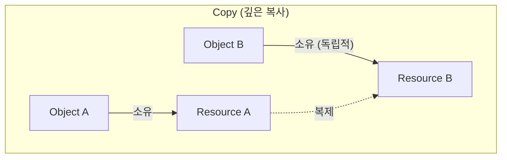
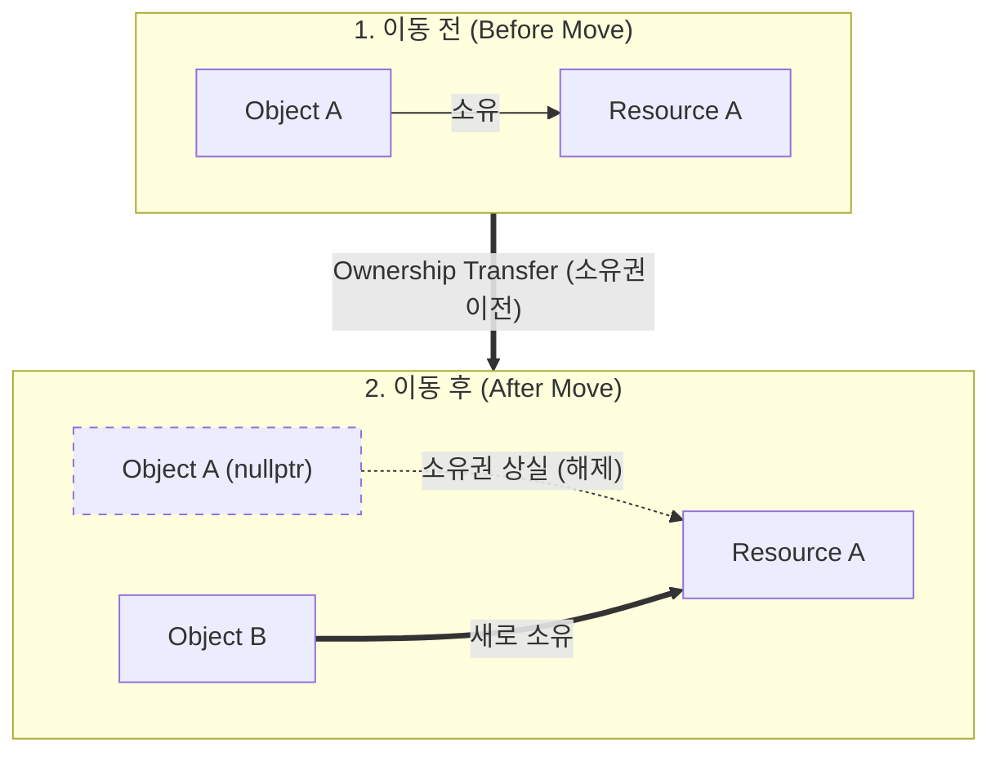
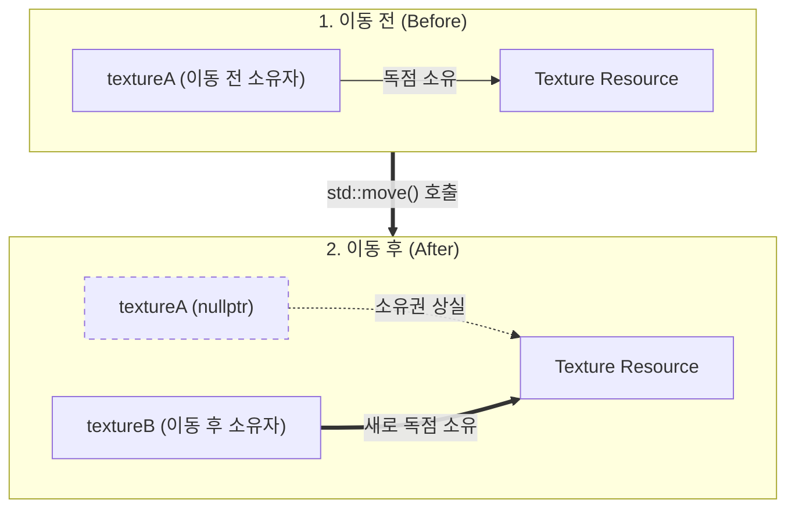

## L-value와 R-value란?

> C++에서는 표현식(Expression)을 크게 L-value와 R-value 등으로 구분

- **L-value:** 특정 객체를 식별할 수 있는 표현식

- **R-value:** 일반적으로 특정 객체의 식별보다는 값이나 계산 결과를 나타내는 표현식

```cpp
int a = 10;
int b = 20;

a = b;
a = 100;
a = a + b;
```

| 표현식 | 분류 | 이유 |
| :--- | :--- | :--- |
| `a` | L-value | 특정 객체 a를 식별 |
| `b` | L-value | 특정 객체 b를 식별 |
| `100` | pure rvalue | 값 자체를 나타냄 |
| `a + b` | pure rvalue | 계산 결과를 나타냄 |

**L-value** 를 단순히 *'왼쪽에 올 수 있는 값'* , **R-value** 를 *'오른쪽에 올 수 있는 값'* 이라고 외우면 안 되는데,

```cpp
int a = 10;
int b = 20;

a = b; // 가능
b = a; // 가능
```

`a`, `b`는 어느 위치에 등장하든 **L-value**

즉, 이름의 유래와 달리 대입 연산자의 좌우 위치만으로 구분하는 개념은 아님

---

## L-value Reference (`T&`)

```cpp
int value = 10;

int& ref = value;
```

`int&`는 **L-value Reference** , 즉, L-value 객체를 참조하는 참조 타입

```cpp
int a = 10;

int& ref = a; // 가능
```

**L-value 객체를 참조하는 참조 타입**

```cpp
int& ref = 10; // 컴파일 오류
```

**10이 Prvalue이기 때문에 컴파일 오류**

L-value Reference 는 기본적으로 일반적인 `비-const` 형태에서는 L-value를 참조해야 함

## 그렇다면 `const` L-value Reference 는?

```cpp
const int& ref = 10;
```

이 코드는 정상적으로 동작

- C++은 `const` L-value Reference가 임시 객체를 참조하는 것을 허용하기 때문

- 개념적으로는 임시 객체가 만들어지고, 참조가 그 객체를 가리키며, 해당 참조의 수명에 맞춰 임시 객체의 수명이 연장되는 방식

이 특징 때문에 함수 인자에서 `const T&` 를 자주 사용

```cpp
void PrintValue(const std::string& value)
{
    std::cout << value;
}

PrintValue("Hello");
```

불필요한 문자열 복사를 피하면서 임시 객체도 전달받을 수 있음

---

## R-value Reference (`T&&`)

```cpp
int&& ref = 10;
```

**L-value Reference와 달리 R-value를 참조할 수 있음**

```cpp
int value = 10;

int& lRef = value;   // L-value 참조
int&& rRef = 10;     // R-value 참조
```

| 참조 종류 | 일반적인 참조 대상 |
| :--- | :--- |
| `T&` | L-value |
| `const T&` | L-value 및 R-value |
| `T&&` | R-value |

그렇다면 **R-value Reference** 는 왜 만들어졌을까?

핵심은 불필요한 복사를 줄이고 자원의 소유권을 효율적으로 이전하기 위해서임

이 개념을 이해하려면 먼저 객체 복사에 대해 살펴봐야 함

---

## 복사와 이동의 차이

```cpp
class Buffer
{
public:
    Buffer(size_t size)
    {
        data = new int[size];
        std::cout << "Buffer Created\n";
    }

    ~Buffer()
    {
        delete[] data;
        std::cout << "Buffer Destroyed\n";
    }

private:
    int* data = nullptr;
};
```

이 클래스는 생성될 때 동적 메모리를 할당을 함

그런데 이 객체를 다른 객체에 전달하거나 복사한다면 어떻게 될까?

- 이 클래스에 기본 복사 기능을 그대로 사용하면 문제가 생길 수 있음

- 컴파일러가 생성하는 기본 복사는 포인터 주소만 복사하는 얕은 복사이기 때문

두 객체가 동일한 메모리를 가리키게 되고, 두 객체의 소멸자가 각각 `delete[]`를 실행하면 문제가 발생

이 문제를 해결하려면 올바른 *복사 생성자* 를 구현 하거나, **이동** 을 지원해야 해야함

---

### 복사(Copy)

**복사는 기존 자원을 유지하면서 새로운 자원을 만드는 방식**



### 이동(Move)

**이동은 기존 자원을 새 객체로 넘겨주는 방식**




이동은 자원 자체를 반드시 물리적으로 복사하는 것이 아님

*ex) 동적 메모리의 주소를 넘겨주고 기존 객체의 포인터를 `nullptr`로 만드는 방식으로 구현할 수 있음*

---

## R-value Reference와 이동 생성자

```cpp
class Buffer
{
public:
    Buffer(size_t size)
    {
        data = new int[size];
    }

    // Move Constructor
    Buffer(Buffer&& other) noexcept
    {
        data = other.data;
        other.data = nullptr;
    }

    ~Buffer()
    {
        delete[] data;
    }

private:
    int* data = nullptr;
};
```

`Buffer`에 이동 생성자를 추가

```cpp
Buffer(Buffer&& other) noexcept
{
    data = other.data;
    other.data = nullptr;
}
```

- `Buffer&&`: R-value Reference

- `other`: 이동 원본 객체

- `noexcept`: 이 이동 생성자는 예외를 던지지 않는다고 선언

원본 객체가 가지고 있던 메모리 주소를 새로운 객체에 전달하고, 원본 객체는 더 이상 그 메모리를 소유하지 않도록 변경하는 것

이렇게 하면 동적 메모리를 새로 할당하고 복사할 필요가 없음

다만 이 예제는 이동 생성자만 구현한 간단한 예제일뿐, **실제로 복사 대입과 이동 대입까지 지원하는 완전한 리소스 관리 클래스는 별도로 설계해야 함**

---

## `std::move` 는 무엇일까?

```cpp
Buffer a(1024);

Buffer b = std::move(a);
```

`std::move`는 객체를 이동시키는 함수가 아니라, 해당 표현식을 **R-value로 취급할 수 있도록 변환하는 도구**

```cpp
Buffer b = static_cast<Buffer&&>(a);
```

개념적으로 다음과 같은 역할을 하며, 그 결과 컴파일러는 이동 생성자를 선택할 수 있게 됌

실제 자원 이동은 선택된 이동 생성자 내부에서 이루어지는 것

```cpp
Buffer a(1024);

Buffer b = std::move(a);
```

이후 `a`는 여전히 유효한 객체, 다만 이동 생성자가 정의한 상태로 남아 있어. 위 예제에서는 `data == nullptr`인 상태가 됌

C++ 표준 라이브러리의 많은 타입은 이동 이후에도 **유효하지만 값이 지정되지 않은 상태(Valid but unspecified state)** 를 보장, 따라서 이동된 객체를 무조건 비어 있다고 가정하면 안 됌

---

## [Rieux Renderer](https://github.com/BOLTB0X/Rieux-Renderer/tree/main)에서 사용하는 스마트 포인터와 연결을 보면

```cpp
std::unique_ptr<Texture> textureA =
    std::make_unique<Texture>();

std::unique_ptr<Texture> textureB =
    std::move(textureA);
```

### 왜 `std::move`가 필요할까?

`unique_ptr` 는 단독 소유권을 갖는 스마트 포인터이기 때문, 두 개의 `unique_ptr`가 같은 객체를 동시에 소유할 수 없음

즉 소유권을 이전하려면 이동해야 함



---