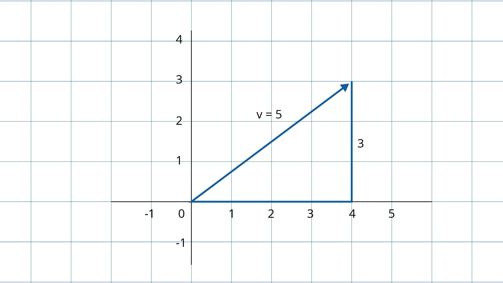
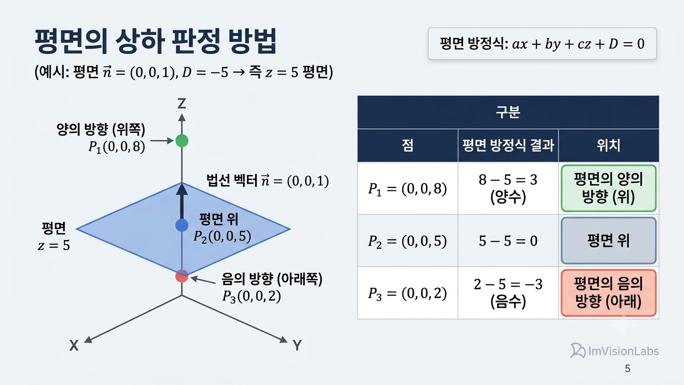
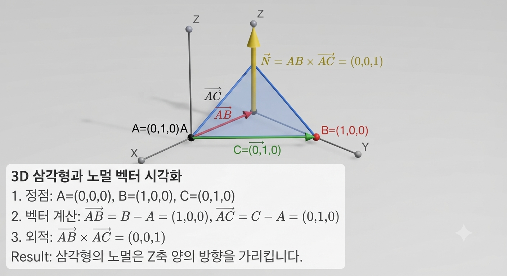
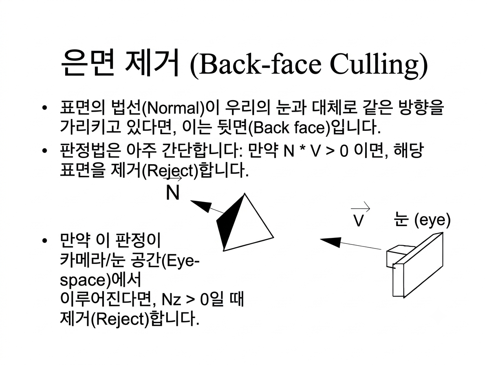

# Vector

**벡터(Vector)는 크기(Magnitude)와 방향(Direction)을 가지는 값**

<div align="center">

|  |  |
| :---: | :---: |
| **위치 (Position)** <br/> 공간에서 특정 지점의 위치 | **방향 (Direction)** <br/> 어느 방향을 향하는지 표현 |

|  |  |
| :---: | :---: |
| **노멀 (Normal)** <br/> 표면이 향하는 수직 방향 | **속도 (Velocity)** <br/> 이동 방향과 이동 속력 |

</div>

3차원 공간에서 벡터는 다음과 같이 표현: $\vec{v} = (x, y, z)$

```cpp
struct Vector3 {
    float x;
    float y;
    float z;
};

Vector3 position  = { 10.0f, 5.0f, 3.0f };
Vector3 direction = {  1.0f, 0.0f, 0.0f };
```

`position`과 `direction`은 둘 다 `Vector3`로 표현할 수 있지만 의미는 다음
- **Position:** 공간상의 위치
- **Direction:** 방향

---

## 벡터의 크기 (Magnitude / Length)

2차원 벡터의 크기

$$
\|\vec{v}\| = \sqrt{x^2 + y^2 }
$$

3차원 벡터의 크기

$$
\|\vec{v}\| = \sqrt{x^2 + y^2 + z^2}
$$

예를 들면 $\vec{v} = (3, 4, 0)$ 이 있으면

<div style="text-align: center;">

</div>

$$
\|\vec{v}\| = \sqrt{3^2 + 4^2 + 0^2} = 5
$$

```cpp
#include <cmath>

struct Vector3 {
    float x, y, z;

    float Length() const {
        return std::sqrt(
            x * x +
            y * y +
            z * z
        );
    }
};
```

두 위치 사이의 거리를 계산할 때도 벡터의 크기를 사용

---

## 정규화 (Normalization)

**벡터의 방향은 유지하면서 크기를 1로 만드는 작업**

정규화된 벡터를 **단위 벡터(Unit Vector)** 라 함

$$
\hat{v}=\frac{\vec{v}}{|\vec{v}|}
$$

위에서 $\vec{v} = (3, 4, 0)$ 크기는 5

각 성분을 5로 나누면  $\vec{v} = (0.6, 0.8, 0)$ 

크기를 다시 계산하면 1 이 나옴 $\|\vec{v}\| = 1$

<div style="text-align: center;">

</div>

```cpp
Vector3 Normalize(Vector3 v) {
    float length = v.Length();

    if (length == 0.0f) return { 0.0f, 0.0f, 0.0f };

    return {
        v.x / length,
        v.y / length,
        v.z / length
    };
}
```

### 왜 정규화가 필요할까?

예를 들어 카메라에서 오브젝트를 향하는 방향을 구한다고 생각해 보면

```cpp
Vector3 direction = targetPosition - cameraPosition;
direction = Normalize(direction);
```

- 정규화를 거치면 두 위치 사이의 거리에 관계없이 방향만 표현할 수 있음

- 특히 **Dot Product, 조명 계산, 카메라 방향 계산** 등에서 정규화된 벡터가 자주 사용

*cf. 주의: 길이가 0인 벡터는 정규화할 수 없음*

----

## 벡터 연산 (Vector Operations)

### 벡터 덧셈 (Addition)

$$
A+B=(A_x+B_x,\ A_y+B_y,\ A_z+B_z)
$$

두 벡터를 더하면 이동량을 합산할 수 있음

```cpp
Vector3 result = {
    a.x + b.x,
    a.y + b.y,
    a.z + b.z
};
```

### 터 뺄셈 (Subtraction)

$$
A-B=(A_x-B_x,\ A_y-B_y,\ A_z-B_z)
$$

두 위치 사이의 방향 벡터를 구할 때 사용

```cpp
Vector3 direction = target - position;
```

### 스칼라 곱셈 (Scalar Multiplication)

$$
A \cdot k=(A_xk,\ A_yk,\ A_zk)
$$

벡터의 크기를 확대하거나 축소할 때 사용

```cpp
Vector3 movement = direction * speed;
```

---

## 벡터 내적 (Dot Product)

**내적은 두 벡터가 얼마나 같은 방향을 향하는지 판단하는 데 사용**

$$
A\cdot B=A_xB_x+A_yB_y+A_zB_z
$$

<div style="text-align: center;">
or
</div>

$$
A\cdot B=|A||B|\cos\theta
$$

$$
\theta = \arccos!\left(\frac{\vec{A} \cdot \vec{B}}{\Vert{}\vec{A}\Vert{} , \Vert{}\vec{B}\Vert{}}\right)$$

```cpp
float Dot(const Vector3& a, const Vector3& b) {
    return a.x * b.x + a.y * b.y + a.z * b.z;
}
```

두 벡터가 단위 벡터라면 결과를 다음과 같이 해석할 수 있음

| 내적 결과 | 의미 |
| :--- | :--- |
| **1** | 같은 방향 |
| **0** | 서로 수직 |
| **-1** | 반대 방향 |

*실제 그래픽스/게임에서는 카메라가 오브젝트를 바라보는지, 조명 방향과 표면 노멀의 각도가 어떤지 판단할 때 사용*

### Dot Product — Frustum Culling

#### Frustum Culling이란?

**카메라의 시야 영역(View Frustum) 밖에 있는 오브젝트를 렌더링 대상에서 제외하는 최적화 기법**

<div style="text-align: center;">
 <br/>
이미지 출처: https://aayushsoni92.medium.com/culling-in-game-development-710e12c347d4
</div>

카메라가 볼 수 있는 영역을 **Frustum** 이라고 하고, 이 영역은 일반적으로 6개의 평면(Plane)으로 구성
- Near Plane
- Far Plane
- Left Plane
- Right Plane
- Top Plane
- Bottom Plane

오브젝트가 이 영역 밖에 있다면 렌더링할 필요가 없음 그렇다면 오브젝트가 Frustum 안에 있는지 어떻게 판단하는 건 **벡터 내적과 평면 방정식을 사용**

#### 평면(Plane)의 기본 구조

3차원 공간에서 평면은 다음 두 가지 정보로 표현할 수 있음

- **Normal Vector:** 평면에 수직인 방향
- **Distance:** 평면이 원점에서 얼마나 떨어져 있는지 나타내는 값

<div style="text-align: center;">
평면 방정식
</div>

$$
Ax+By+Cz+D=0
$$

여기서 평면의 노멀은 다음과 같은데

$$
\vec{n}=(A,B,C)
$$

어떤 점 $P=(x,y,z)$ 가 평면의 어느 쪽에 있는지 확인하려면 다음 값을 계산

$$
\text{Distance}(P)=\vec n\cdot P+D
$$

즉, **내적을 이용해서 점과 평면의 상대적인 위치를 판단하는 것**

#### 내적으로 평면과 점의 위치 판단하기

평면이 다음과 같다고 가정해 보면

$$
\vec n=(0,0,1),\quad D=-5
$$

이 평면은 `Z = 5` 인 평면이고 세 점을 비교해 보면

<div style="text-align: center;">
 <br/>
AI 생성 이미지
</div>

- **결과가 양수:** 평면의 내부 쪽
- **결과가 음수:** 평면의 외부 쪽
- **결과가 0:** 평면 위

이때 평면 노멀의 방향을 반대로 설정했다면 부호 해석도 반대가 됌

#### 실제 Culling에서는 점 하나만 검사하지 않는다

오브젝트는 점이 아니라 일정한 크기를 가진 Mesh, 그래서 보통 **Bounding Volume(경계 볼륨)** 을 사용

<div align="center">

|  |  |
| :---: | :---: |
| **Bounding Sphere** <br/> 중심점과 반지름으로 검사 | **AABB** <br/> 최소·최대 좌표로 검사 |
</div>

1. Bounding Sphere

    - 구의 중심: $C$
    - 구의 반지름: $r$
    - 평면까지의 부호 있는 거리: $d$

    평면 노멀이 단위 벡터라면 다음 조건으로 구가 완전히 평면 바깥에 있는지 판단할 수 있음. $d < -r$

    즉, 구의 가장 가까운 부분까지도 평면 바깥에 있다는 뜻

    ```cpp
    bool IsOutsidePlane(
    const Plane& plane,
    const Vector3& center,
    float radius) {
        float distance =
            Dot(plane.normal, center) + plane.d;

        return distance < -radius;
    }
    ```

    - 실제 Frustum Culling에서는 이 검사를 6개 평면에 대해 수행

    - 어느 한 평면이라도 완전히 바깥이라면 해당 오브젝트는 Culling 대상

2. **AABB**

    ```cpp
    bool IsOutsidePlane(const Plane& plane, const AABB& box) {
        float distance = Dot(plane.normal, box.center) + plane.d;

        // AABB 반길이를 평면 법선에 투영한 최대 반경(항상 양수여야 하므로 절댓값 사용)
        float effectiveRadius =
            box.extents.x * std::fabs(plane.normal.x) +
            box.extents.y * std::fabs(plane.normal.y) +
            box.extents.z * std::fabs(plane.normal.z);

        return distance < -effectiveRadius;
    }
    ```
---

## 외적 (Cross Product)

**외적은 두 3차원 벡터를 입력받아 두 벡터 모두에 수직인 새로운 벡터를 반환**

$$
C=A\times B
$$

$$
\vec{A} \times \vec{B} = \begin{pmatrix} A_y B_z - A_z B_y \\ A_z B_x - A_x B_z \\ A_x B_y - A_y B_x \end{pmatrix}
$$

크기(노름)를 포함한 표현이 필요할 때는

$$
\Vert{}\vec{a} \times \vec{b}\Vert{} = \Vert{}\vec{a}\Vert{} \, \Vert{}\vec{b}\Vert{} \sin\theta
$$

<div style="text-align: center;">

</div>

외적의 방향은 오른손 법칙(Right-Hand Rule)으로 결정

다음과 같은 상황에서 활용

- 삼각형의 노멀 벡터 계산
- 카메라의 Right Vector 계산
- 두 방향에 수직인 벡터 생성

예를 들어 카메라의 **Forward** 와 **Up 벡터** 가 주어졌을 때 **Right Vector** 를 구할 수 있어음

```cpp
Vector3 right = Normalize(Cross(forward, up));
```

*cf. 실제 결과의 방향은 좌표계와 외적 순서에 따라 달라짐, DirectX의 일반적인 왼손 좌표계라고 해서 외적의 수학적 정의 자체가 달라지는 것은 아님*

### Cross Product — Backface Culling

**Backface Culling은 카메라를 바라보지 않는 삼각형의 뒷면을 렌더링하지 않는 기법**

<div style="text-align: center;">

</div>

*큐브의 앞면은 카메라를 향하고 있지만, 뒷면은 카메라 반대쪽을 향하고 있는데*

일반적인 닫힌 표면에서는 뒷면을 그리지 않아도 내부가 보이지 않기 때문에 렌더링 비용을 줄일 수 있음

그렇다면 삼각형의 앞면과 뒷면을 어떻게 구분할까? -> **외적으로 구한 Normal Vector를 활용할 수 있음**

#### 삼각형의 노멀 계산하기

삼각형의 세 정점이 있다고 가정해 보면 $A,\ B,\ C$

먼저 두 개의 변 벡터를 만들어 

$$\vec{AB}=B-A$$

$$
\vec{AC}=C-A
$$

그다음 외적을 계산

$$
\vec N=(B-A)\times(C-A)
$$

이렇게 하면 삼각형 표면에 수직인 노멀 벡터를 구할 수 있음

<div style="text-align: center;">

<br/> 이미지 출저: https://3dengine.readthedocs.io/modules/backface_culling.html
</div>

<div style="text-align: center;">

<br/> AI 생성 이미지
</div>

```cpp
Vector3 ComputeNormal(
    Vector3 a,
    Vector3 b,
    Vector3 c) {
    Vector3 ab = b - a;
    Vector3 ac = c - a;

    return Normalize(Cross(ab, ac));
}
```

#### 노멀과 카메라 방향의 내적

이제 노멀을 구했으니 카메라가 삼각형의 어느 쪽에 있는지 판단해 보면

삼각형의 중심에서 카메라를 향하는 벡터를 구함

$$
\vec V=CameraPosition-TriangleCenter
$$

<div style="text-align: center;">

</div>


두 벡터가 단위 벡터라면 다음처럼 해석


| 내적 결과 | 의미 |
| :--- | :--- |
| 양수 | 노멀과 카메라 방향이 같은 반구에 있음 |
| 0 | 서로 수직 |
| 음수 | 노멀과 카메라 방향이 반대 반구에 있음 |

정점 순서와 노멀 방향을 기준으로 하면 다음처럼 판단할 수 있음

```cpp
Vector3 normal = ComputeNormal(a, b, c);

Vector3 viewDir =
    Normalize(cameraPosition - triangleCenter);

float dotValue = Dot(normal, viewDir);

if (dotValue <= 0.0f) {
    // Backface로 판단하여 제외
}
```

---


## 참고

- [Learn OpenGL](https://learnopengl.com/Getting-started/Transformations)

- [w3e.kanazawa 이미지 참고](https://w3e.kanazawa-it.ac.jp/math/physics/high-school_index/mechanics/motion/henkan-tex.cgi?list=1&target=%2Fmath%2Fphysics%2Fhigh-school_index%2Fmechanics%2Fmotion%2Fposition.html)

- [hopific 이미지 참고](https://hopific.com/how-to-extrude-a-curve-in-grasshopper/)

- [maxicours 이미지 참고](https://www.maxicours.com/se/cours/la-caracterisation-d-un-plan/)

- [kristianstolen 이미지 참고](https://www.kristianstolen.com/vector/math/2023/01/10/vectors.html)

- [medium - Culling in Game Development(Reyansh Soni)](https://aayushsoni92.medium.com/culling-in-game-development-710e12c347d4)

- [hojinchoi 이미지 참고](https://hojinchoi.vercel.app/omb2)

- [cgraph - backculling](https://cgraph.ru/node/495)