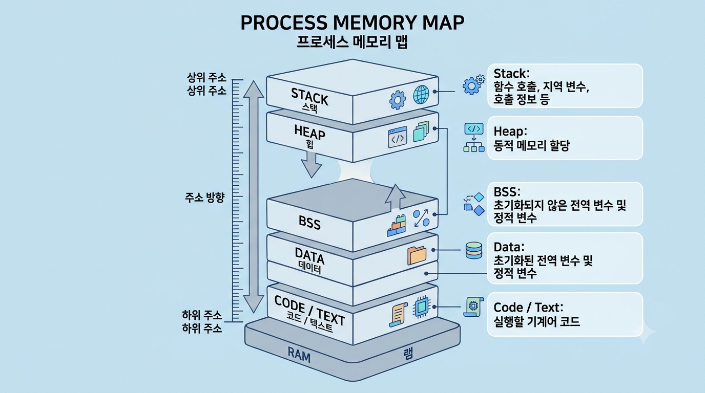
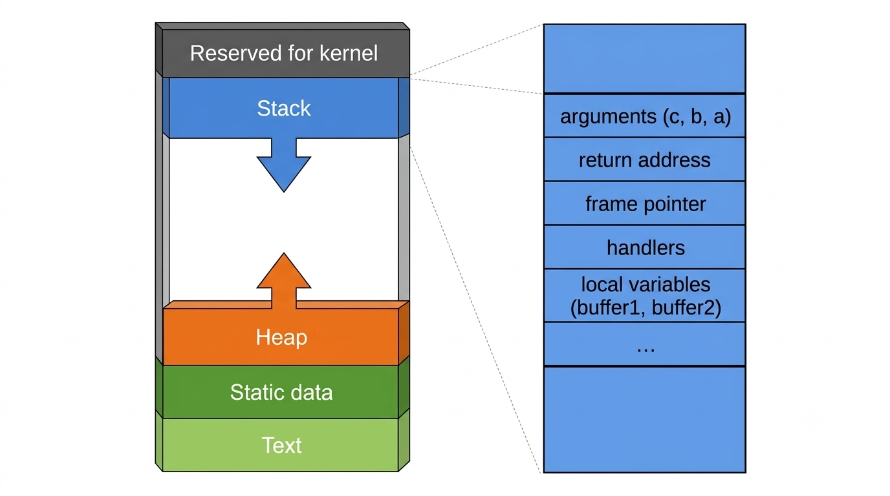
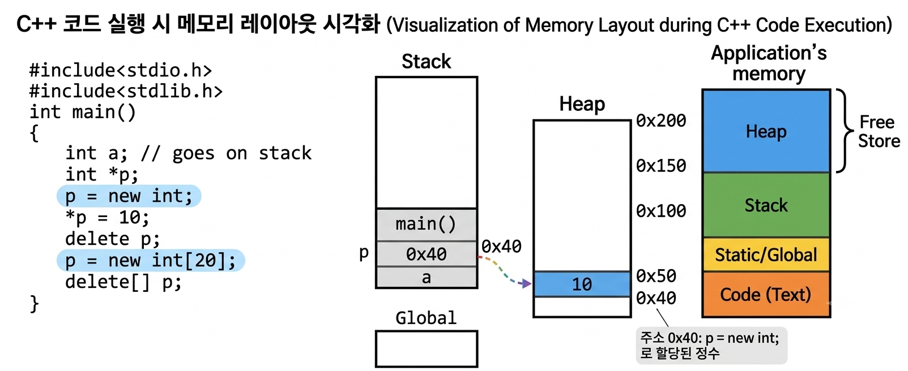
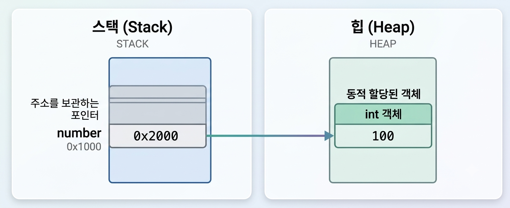
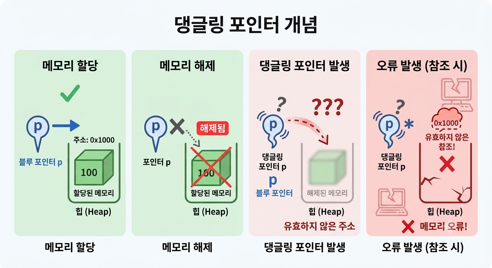

# Memory

<p align="center">
  
  <br/> 표 내용을 바탕으로 AI 생성 이미지
</p>


| 영역 | 역할 |
| :--- | :--- |
| **Code / Text** | 실행할 기계어 코드 |
| **Data** | 초기화된 전역 변수 및 정적 변수 |
| **BSS** | 초기화되지 않은 전역 변수 및 정적 변수 |
| **Heap** | 동적 메모리 할당 |
| **Stack** | 함수 호출, 지역 변수, 호출 정보 등 |

---

## 0. Stack과 Heap

**Stack과 Heap은 `C++`가 직접 정의하는 메모리 영역이 아니라, 일반적인 실행 환경과 운영체제 및 API에서 사용하는 메모리 관리 방식**

---

## 1. Stack Memory

<p align="center">
  
  <br/> AI 생성 이미지, cf: https://yanxurui.cc/posts/misc/2019-05-01-Computer-Security-Overview/
</p>

> Stack은 함수 호출과 관련된 정보를 관리하는 데 사용되는 메모리 영역

- 지역 변수
- 함수의 매개변수
- 반환 주소
- 레지스터 저장 정보 등

**Stack에 저장된 객체는 해당 객체의 수명이 끝날 때 자동으로 소멸**

### 1.1 ex) 코드가 실행되면 일반적으로 발생된 과정

```cpp
#include <iostream>

void Function()
{
    int value = 100;
    float ratio = 3.14f;
}

int main()
{
    int number = 10;

    Function();

    return 0;
}
```

1. `main()` 호출

   `main()`의 실행에 필요한 Stack Frame이 만들어지고 `number`가 저장

2. `Function()` 호출

   새로운 Stack Frame이 만들어지고 `value`, `ratio`가 저장

3. `Function()` 종료

   `Function()`의 Stack Frame이 정리, 이때 `value`, `ratio`의 생명주기도 종료

4. `main()`으로 복귀

   `number`는 여전히 유효, `main()`이 종료될 때 생명주기가 끝남

---

### 1.2 Stack의 주요 특징

- 함수 호출과 반환에 따라 자동으로 관리됌

- 일반적으로 메모리 할당 및 해제 비용이 낮음

- 로컬 객체는 스코프를 벗어나면 소멸함

- 일반적으로 사용 가능한 공간이 제한적

### 1.3 Stack Overflow

> 프로그램이 할당받은 Stack 메모리 영역의 한계를 초과하여 데이터를 계속 쌓으려고 할 때 발생하는 오류

Stack은 크기가 제한적이기 때문에, 허용된 용량을 넘기면 프로그램이 비정상적으로 종료가 됌

#### 주요 발생 원인

- **무한 재귀 호출 (Infinite Recursion)** : 종료 조건이 없거나 잘못된 재귀 함수가 자기 자신을 끝없이 호출하면서 함수 호출 정보(스택 프레임)가 계속 쌓일 때 가장 흔하게 발생함

- **과도하게 큰 지역 변수 선언** : 함수 내부에 아주 큰 크기의 배열이나 무거운 객체를 지역 변수로 선언하여 단번에 Stack 용량을 초과할 때 발생함

- **너무 깊은 함수 호출 체인** : 함수 A가 B를, B가 C를 호출하는 과정이 수천, 수만 단계 이상 지나치게 깊어질 때 발생함

#### 주요 해결 및 예방 방법

- **재귀 함수 종료 조건 점검** : 재귀 호출 시 반드시 기저 조건(Base Case)에 도달하여 함수가 반환되도록 설계

- **동적 할당(Heap) 활용** : 크기가 큰 배열이나 객체는 Stack 대신 용량이 훨씬 큰 Heap 영역에 동적 할당(ex: `std::vector`, 스마트 포인터 등)하여 사용

- **반복문으로 대체** : 깊이가 깊어질 수 있는 재귀 로직은 `for`나 `while` 같은 일반 반복문으로 변경하여 스택 프레임이 쌓이는 것을 방지

---

## 2. Heap Memory

<p align="center">
  
  <br/> AI 생성 이미지, cf: https://yanxurui.cc/posts/misc/2019-05-01-Computer-Security-Overview/
</p>


**Heap은 프로그램 실행 중에 필요한 메모리를 동적으로 할당받아 사용하는 영역**

Stack과 가장 큰 차이는 메모리의 할당과 해제를 개발자가 제어할 수 있다는 것

### 2.1 ex) 코드가 실행되면 일반적으로 발생된 과정

```cpp
#include <iostream>

int main()
{
    int* number = new int(100);

    std::cout << *number << std::endl;

    delete number;
    number = nullptr;

    return 0;
}
```

1. 포인터 변수 선언

   ```cpp
   int* number;
   ```

   `number`라는 포인터 변수가 선언되고, 이 변수는 일반적인 실행 환경에서 `main()`의 Stack Frame에 저장될 수 있음

2. Heap 메모리 할당

   ```cpp
   number = new int(100);
   ```

   - Heap에 int 객체를 저장할 메모리를 요청함
   
   - 해당 메모리에 int 객체를 생성하고 100으로 초기화함

   - 객체의 주소를 반환

   - 반환된 주소를 Stack에 있는 number에 저장함

   <p align="center">
   
   </p>

3. Heap 메모리 해제

   ```cpp
   delete number;
   ```

   Heap에 생성했던 객체의 소멸자가 호출되고, 해당 동적 메모리가 할당 해제

4. `nullptr` 대입

   - 포인터가 더 이상 유효하지 않은 메모리를 가리키지 않도록 초기화하는 것

   - 주의할 점은 `delete`가 포인터 변수를 없애는 것이 아님

   - `number`라는 포인터 변수는 여전히 존재하지만, Heap에 있던 객체는 소멸한 상태


| 구분 | Stack | Heap |
| :--- | :--- | :--- |
| **관리** | 자동 | 동적 할당 및 해제 |
| **할당** | 일반적으로 빠름 | 상대적으로 비용이 발생 |
| **수명** | 스코프 및 객체 수명에 따름 | 동적 객체의 수명에 따름 |
| **크기** | 일반적으로 제한적 | 상대적으로 큰 공간 사용 가능 |
| **관리 방식** | 자동 객체 생명주기 | 명시적 관리 또는 스마트 포인터 |
| **주요 위험** | Stack Overflow | Memory Leak, Fragmentation |


## 3. Stack이 Heap보다 무조건 빠른가?

일반적으로 Stack 할당은 Stack Pointer를 이동시키는 정도로 끝나기 때문에 매우 저렴

반면 Heap 할당은 메모리 할당 관리자가 적절한 블록을 찾아야 하고, 할당 및 해제 과정에서 추가적인 관리 비용이 발생할 수 있음

하지만 무조건 Stack이 빠르다고 단정하면 위험

실제 성능은 다음 요소에도 영향을 받는데

- 메모리 접근 패턴
- Cache Locality
- 메모리 할당 크기
- 메모리 단편화
- 할당자 구현

*ex Heap에 연속적으로 할당한 `std::vector`는 데이터 접근 측면에서 좋은 Cache Locality를 가질 수 있음*

## 4.Heap은 Stack보다 무조건 큰가?

일반적으로 프로세스에서 Heap은 Stack보다 더 많은 메모리를 활용할 수 있음

하지만 실제 크기는 운영체제, 프로세스 설정, 가상 메모리 환경 등에 따라 달라지는데

Stack도 무한하지 않기 때문에 너무 큰 지역 배열을 선언하면 **Stack Overflow가 발생할 수 있음**

```cpp
int main()
{
    int hugeArray[100000000];

    return 0;
}
```

이런 코드는 일반적인 환경에서 Stack 공간을 초과할 가능성이 높음

반면 다음과 같이 동적 할당을 사용하면 Stack에 거대한 배열을 직접 배치하는 문제는 피할 수 있음

```cpp
int main()
{
    int* hugeArray = new int[100000000];

    delete[] hugeArray;

    return 0;
}
```

*cf. 물론 이 코드도 메모리 부족이나 할당 실패 가능성은 있음*

## 5. 그래픽스 프로그래밍에서의 Stack과 Heap

예를 들어 DX12에서 다음과 같은 코드가 있다고 가정

```cpp
void Renderer::Render()
{
    Camera camera;

    std::vector<Mesh> meshes;

    ID3D12GraphicsCommandList* commandList = nullptr;

    // Rendering...
}
```

| 객체 | 일반적인 메모리 관리 |
| :--- | :--- |
| **camera** | 지역 객체, 자동 저장 기간 |
| **meshes** | vector 객체 자체는 지역 객체, 내부 원소 메모리는 동적 할당 가능 |
| **commandList** | 포인터 변수는 지역 객체, 가리키는 COM 객체는 별도 관리 |

```cpp
std::vector<Mesh> meshes;
```

`meshes`라는 `vector` 객체 자체는 지역 변수로 선언됐지만, 내부 원소를 저장하는 메모리는 일반적으로 동적으로 할당 됌

**즉, 하나의 객체가 Stack과 Heap 양쪽의 메모리와 연관될 수 있는 것**

그리고 `commandList`는 포인터 자체와 실제로 가리키는 객체의 수명을 구분해야 함

---

## 5. Object Lifetime

> C++에서 객체는 생성되는 순간부터 소멸되는 순간까지 유효한 수명을 가지ㅁ

이 기간을 Object Lifetime(객체 생명주기) 이라고 함

### 5.1 ex) code

```cpp
class Texture
{
public:
    Texture()
    {
        std::cout << "Texture Created\n";
    }

    ~Texture()
    {
        std::cout << "Texture Destroyed\n";
    }
};

void Render()
{
    Texture texture;
}
```

### 5.2 `Texture` 객체의 생명주기

1. 객체 생성
   
   `Texture texture;`
   
   생성자 호출 및 객체 수명 시작

2. 객체 사용
   
   `Render()` 함수 내부에서 객체 사용

3. Scope 종료
   
   `Render()` 함수가 반환됨

4. 객체 소멸
   
   소멸자 호출 및 객체 수명 종료

여기서 중요한 것은

- **생성자(Constructor)** : 객체가 올바른 상태로 사용될 수 있도록 초기화
- **소멸자(Destructor)** : 객체가 소유한 자원을 정리하고 객체 수명을 마무리

단순히 메모리 공간을 확보하고 해제하는 것만이 아닌, 객체가 가진 자원까지 관리하는 것이 C++ 객체 모델의 핵심

### 5.3 동적 객체의 생명주기

```cpp
void Render()
{
    Texture* texture = new Texture();

    // Texture 사용

    delete texture;
}
```

이 경우 객체의 수명은 함수의 Scope와 직접적으로 연결되지 않음

`Render()` 함수가 종료되기 전이라도 delete를 호출하면 객체는 소멸

반대로 함수가 종료되어도 delete를 호출하지 않았다면 객체는 계속 존재할 수 있음

즉, **객체의 수명은 저장 영역만으로 결정되는 것이 아니라 객체의 저장 기간과 생성·소멸 규칙에 따라 결정**

---

## 6. Scope와 Lifetime의 차이

| 개념 | 의미 |
| :--- | :--- |
| Scope | 변수나 이름을 코드에서 참조할 수 있는 범위 |
| Lifetime | 객체가 실제로 존재하는 기간 |

```cpp
Texture* CreateTexture()
{
    Texture* texture = new Texture();

    return texture;
}

void Render()
{
    Texture* texture = CreateTexture();

    // Texture 객체 사용 가능

    delete texture;
}
```

`CreateTexture()` 내부의 포인터 변수 `texture`는 함수가 종료되면 **Scope** 가 끝남

**`CreateTexture()` 실행부터 반환 이후까지**

* **지역 포인터 변수**: `CreateTexture()` 함수가 끝나면 수명 종료
* **동적 Texture 객체**: `CreateTexture()` 반환 후에도 존재하며 `delete` 시 소멸

---

## 7. Dangling Pointer

<p align="center">
  
  <br/> AI 생성 이미지, cf: https://yanxurui.cc/posts/misc/2019-05-01-Computer-Security-Overview/
</p>

**이미 수명이 끝난 객체의 메모리를 여전히 가리키고 있는 포인터**

### 7.1 코드가 문제인 이유

```cpp
int* CreateValue()
{
    int value = 100;

    return &value;
}

int main()
{
    int* ptr = CreateValue();

    std::cout << *ptr;

    return 0;
}
```


`CreateValue()` 내부의 value는 지역 변수

1. `value` 생성
2. `value`에 100 저장
3. `&value` 반환
4. 함수 종료
5. `value`의 수명 종료
6. `ptr`은 이미 수명이 끝난 객체의 주소를 보유

결국 `ptr`은 유효한 객체를 가리키지 않음

이 상태에서 `*ptr로` 접근하면 Undefined Behavior(정의되지 않은 동작) 가 발생

### 7.2 Dangling Pointer가 발생하는 대표적인 상황 

#### 1) 지역 변수의 주소 반환

```cpp
int* GetValue()
{
    int value = 10;
    return &value;
}
```

지역 객체의 수명이 함수 종료와 함께 끝나기 때문

#### 2) 이미 해제된 메모리 접근

```cpp
int* ptr = new int(100);

delete ptr;

std::cout << *ptr; // 잘못된 접근
```

#### 3) 객체가 먼저 소멸한 경우

```cpp
Texture* ptr = nullptr;

{
    Texture texture;
    ptr = &texture;
}

// texture 소멸

// ptr은 더 이상 유효한 객체를 가리키지 않음
```

### 7.3 `nullptr` 을 대입하면 해결될까?

```cpp
delete ptr;
ptr = nullptr;
```

해당 포인터 변수를 더 이상 사용하지 않도록 만드는 좋은 습관임

하지만 주의해야 case가 존재

```cpp
int* ptrA = new int(100);
int* ptrB = ptrA;

delete ptrA;
ptrA = nullptr;
```

`ptrA` 는 안전하게 초기화됐지만 `ptrB` 는 여전히 해제된 메모리 주소를 가지고 있음

#### 하나의 객체를 여러 포인터가 가리키는 상황

* **동적 객체**: `delete`로 수명 종료
* **`ptrA`** → `nullptr`
* **`ptrB`** → Dangling

> 포인터 하나를 `nullptr`로 초기화해도 다른 포인터까지 자동으로 변경되지는 않음
