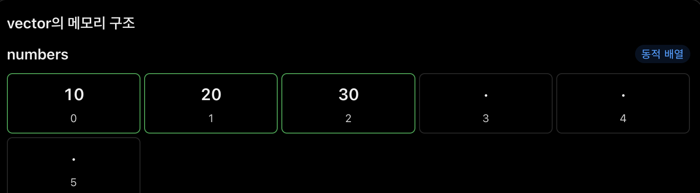
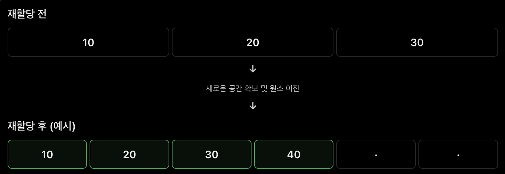

# Vector

> `std::vector`는 **동적 배열(Dynamic Array)** 을 구현한 C++ 표준 컨테이너

<div style="text-align: center;">

<br/> AI 생성이미지, 원본 이미지 출처: https://cloud.tencent.com/developer/article/2604017
</div>

- **컨테이너 (container)**

    같은 타입의 객체를 저장 , 관리할 목적으로 만들어진 Class

- **반복자 (iterator)**

   어떤 컨테이너에 접근하든 동일한 방법으로 접근하기 위해서 제공되는 객체

객체들을 순차적으로 보관하는 **시퀀스 컨테이너 (sequence container)** 와 키를 바탕으로 대응되는 값을 찾아주는 **연관 컨테이너 (associative container)** 존재

---

## `std::vector`

>  **시퀀스 컨테이너 (sequence container)** 중 대표적인게 vector

```cpp
#include <vector>
```

```cpp
vector<data type> [변수 명] 
```

- 배열과 달리 크기가 자동으로 조절됨

- 메모리가 **연속적(contiguous)** 으로 할당됨

- `std::vector<int>`, `std::vector<string>` 처럼 템플릿을 통해 다양한 타입 저장 가능

## 기본 사용법

```cpp
std::vector<int> v;

v.push_back(10);
v.push_back(20);
v.push_back(30);

for (int i = 0; i < v.size(); i++)
    std::cout << v[i] << " ";
    // 10 20 30 
```

- `push_back()` : 요소 추가

- `v[i]` : 배열처럼 인덱스로 접근

```cpp
std::vector<int> a = {1, 2, 3}; // 초기화
std::vector<int> b(5, 100); // 5개의 100으로 초기화
std::vector<int> c(b); // 복사 생성

v = std::vector<int>(5, 0);
```

---

## 주요 맴버 메소드

<details>
<summary>클릭해서 펼치기 </summary>

### `push_back()` : 뒤에 값 추가

```cpp
v.push_back(10);
```

### `pop_back()` : 마지막 요소 제거

```cpp
v.pop_back();
```

### `size()` : 요소의 개수 , 벡터의 길이

```cpp
v.size();
```

### `capacity()` : 현재 할당된 메모리 크기

```cpp
v.capacity()
```

### `resize(n)` : 크기 재설정

```cpp
v = {10, 20, 40, 50, 60};
```

- **크기 줄이기** : 뒤에 요소부터 pop

    ```cpp
    v.resize(3);
    ```

    ```cpp
    for (int i : v) 
        std::cout << i << " ";
    std::cout << "\n";

    // 10 20 40
    ```

    ---

- **크기 늘리기** : 뒤에서 부터 채워짐

   ```cpp
   v.resize(5, 70);
   ```

   ```cpp
   for (int i : v) std::cout << i << " ";
   std::cout << "\n";
   // resize(5, 9): 10 20 40 70 70
   ```
   
   ---


### `clear()` : 모든 요소 삭제

```cpp
v.clear();
```

### `empty()` : 비었는지 확인, `bool` 반환

```cpp
v.empty()
```

```cpp
std:: cout << v.empty() << '\n'; // 0
```

### `front()` : 벡터의 첫 번째 요소를 반환 

```cpp
v.front();
```

`v[0]` 반환

```cpp
std::cout << "front : " << v.front() << "\n"; // 10
```

### `back()` : 벡터의 마지막 요소를 반환 

```cpp
v.back();
```

`v[v.size() - 1]` 반환

```cpp
std::cout << "back(): " << v.back() << "\n";   // 50
```

### `begin()`

```cpp
v.begin();
```

벡터의 **첫 번째 요소를 가리키는 반복자(iterator)** 를 반환

### `end()`

```cpp
v.end();
```

벡터의 **마지막 요소의 다음을 가리키는 반복자** 를 반환

```cpp
// begin()과 end()를 사용한 반복
for (std::vector<int>::iterator it = v.begin(); it != v.end(); ++it) {
    std::cout << *it << " ";
}
```

C++11 이후

```cpp
std::cout << "auto 사용 : ";
for (auto it = v.begin(); it != v.end(); ++it) {
    std::cout << *it << " ";
}
```

### `insert(pos, val)` : 특정 위치에 삽입

```cpp
v.insert(v.begin() + 2, 80);
std::cout << "insert at index 2: ";
for (int i : v) std::cout << i << " ";
std::cout << "\n";

// insert at index 2: 10 20 80 40 70 70
```

### `erase(pos)` : 특정 위치 요소 제거

```cpp
v.erase(v.begin() + 4);
std::cout << "erase at index 4: ";
for (int i : v) std::cout << i << " ";
std::cout << "\n";
// erase at index 4: 10 20 80 40 70
```

</details>

---


##  반복자(iterator) 이용

<details>
<summary>클릭해서 펼치기 </summary>

```cpp
for (std::vector<int>::iterator it = v.begin(); it != v.end(); ++it) {
    std::cout << *it << " ";
}
```

또는 C++11 이후

```cpp
for (int val : v) {
    std::cout << val << " ";
}
```

```cpp
// 2차원
std::vector<std::vector<int>> matrix(3, std::vector<int>(3, 0));
```

</details>

---

## vector의 메모리 구조와 내부 관리

`std::vector`는 동적 배열, 일반 배열과 가장 큰 차이점은 실행 중에 필요한 만큼 저장 공간을 확장할 수 있다는 것

```cpp
std::vector<int> numbers;

numbers.push_back(10);
numbers.push_back(20);
numbers.push_back(30);
```

<div style="text-align: center;">

<br/> AI 이미지 생성
</div>

`numbers`는 내부적으로 연속된 메모리 공간을 사용

---

### `size()` 와 `capacity()`

```cpp
std::vector<int> numbers;

numbers.reserve(5);

numbers.push_back(10);
numbers.push_back(20);
numbers.push_back(30);

std::cout << numbers.size() << '\n'; // 3
std::cout << numbers.capacity() << '\n'; // 5
```

`reserve(5)`는 최소 5개의 원소를 저장할 수 있는 용량을 확보

- 여기서 중요한 점은 `reserve()`가 원소를 생성하는 함수가 아니라는 것
- `numbers[3]`이나 `numbers[4]`에 접근하는 것은 올바르지 않음

---

### `capacity`가 부족해지면?

```cpp
std::vector<int> numbers;

numbers.reserve(3);

numbers.push_back(10);
numbers.push_back(20);
numbers.push_back(30);

// ...


numbers.push_back(40); // ?
```

기존 공간에 추가할 여유가 없으므로 `vector`는 새로운 메모리 공간을 확보해야하는 상황

이 과정을 **재할당(Reallocation)** 이라고 함

일반적인 재할당 과정
1. 새로운 메모리 공간 확보
2. 기존 원소를 새로운 공간으로 이동 또는 복사
3. 새로운 원소 생성
4. 기존 원소들의 수명 종료 및 이전 메모리 해제

<div style="text-align: center;">

<br/> AI 이미지 생성
</div>

**중요한 것은 기존 원소가 단순히 메모리 주소만 바뀌는 것이 아니라, 새로운 공간에 객체가 이동 또는 복사 생성된다는 것**

이 때문에 재할당이 발생하면 기존 원소를 가리키던 포인터, **참조, Iterator가 무효화**

---

### `vector` 는 객체도 관리한다

vector에는 사용자 정의 클래스 객체도 저장 가능

```cpp
class Monster {
public:
    Monster(int hp)
        : hp(hp) {
        std::cout << "Constructor" << '\n';
    }

    ~Monster() {
        std::cout << "Destructor" << '\n';
    }

private:
    int hp;
}

// ...

int main() {

    // ...

    std::vector<Monster> monsters;

    monsters.emplace_back(100);
    monsters.emplace_back(200);

    return 0;
}
```

여기서 `vector`는 메모리 공간뿐 아니라 원소 객체의 생성과 소멸도 관리
- 원소를 추가하면 객체가 생성
- 원소를 삭제하면 해당 객체의 소멸자가 호출
- `vector` 자체가 소멸하면 남아 있는 원소들도 소멸

이것은 C++의 객체 수명과 RAII 개념이 STL 컨테이너에서도 적용된다는 뜻

---

### `push_back()`과 `emplace_back()`의 차이

> 두 함수 모두 `vector`의 마지막 위치에 원소를 추가한다는 공통점이 존재

하지만 객체를 전달하는 방식과 생성하는 방식에 차이가 존재

#### `push_back()`: 이미 만들어진 객체를 `vector`에 추가하는 함수

```cpp
push_back(const T& value);
push_back(T&& value);
```

- `const T&`: 기존 객체를 복사해서 추가
- `T&&`: 기존 객체를 이동해서 추가

```cpp
class Monster {
public:
    Monster(int hp)
        : hp(hp) {
        std::cout << "Constructor" << '\n';
    }

    ~Monster() {
        std::cout << "Destructor" << '\n';
    }

    Monster(Monster&& other) noexcept
        : hp(other.hp) {
        std::cout << "Move Constructor" << '\n';
    }

private:
    int hp;
};

int main() {
    // ...
    std::vector<Monster> monsters;

    Monster monster(100);

    monsters.push_back(monster);

    monsters.push_back(std::move(monster));
    // ...
}
```

```
Constructor
Copy Constructor
Move Constructor
```

각각의 동작은 다음과 같음
1. `Monster monster(100)`에서 객체 생성
2. `push_back(monster)`에서 기존 객체를 복사
3. `push_back(std::move(monster))`에서 기존 객체를 이동

**여기서 `std::move()`는 객체 자체를 이동시키는 함수가 아니라, 해당 객체를 이동 가능한 상태로 취급할 수 있도록 우측값 참조로 변환하는 도구, 실제 이동은 이동 생성자가 수행**

#### `emplace_back()`

**객체를 전달하는 대신 생성자에 필요한 인자를 전달하여 `vector` 내부에서 객체를 생성하는 함수**

```cpp
int main() {
    std::vector<Monster> monsters;

    monsters.emplace_back(100);

    return 0;
}
```

```
Constructor
```

**기존에 `Monster` 객체를 별도로 생성하지 않고, 생성자 인자를 전달해 `vector`의 원소를 직접 생성**

| 구분 | push_back | emplace_back |
| :--- | :--- | :--- |
| **전달 대상** | 객체 | 생성자 인자 |
| **복사 가능** | O | O |
| **이동 가능** | O | O |
| **내부 생성** | 전달 객체를 복사·이동 | 생성자 인자로 직접 생성 |
| **주된 목적** | 객체 추가 | 객체 직접 생성 |

#### 그렇다면 `emplace_back`이 항상 빠를까?

흔히 `emplace_back()`이 `push_back()`보다 무조건 빠르다고 생각하는데, 정확하지 않음

```cpp
Monster monster(100);
monsters.push_back(std::move(monster)); // 이미 생성된 객체를 이동 생성자를 이용해 추가

// vs

monsters.emplace_back(100); // 생성자 인자를 전달해 원소를 직접 생성
```

**두 방식 모두 불필요한 복사를 피할 수 있음**

또한 `vector`의 `capacity`가 부족하면 어느 방식을 사용하든 기존 원소들을 이동하거나 복사하는 재할당 비용이 발생 가능성이 존재

기본 선택 기준은
- 이미 만들어진 객체를 추가한다면 `push_back()`
- 생성자 인자를 전달해 새 객체를 만들고 싶다면 `emplace_back()`

---


## 참고

- [모두의 코드 - 씹어먹는 C++ - <10 - 1. C++ STL - 벡터(std::vector), 리스트(list), 데크(deque)>](https://modoocode.com/223)

- [블로그 참고 - 가면 뒤의 기록(vector container 정리 및 사용법)](https://blockdmask.tistory.com/70)